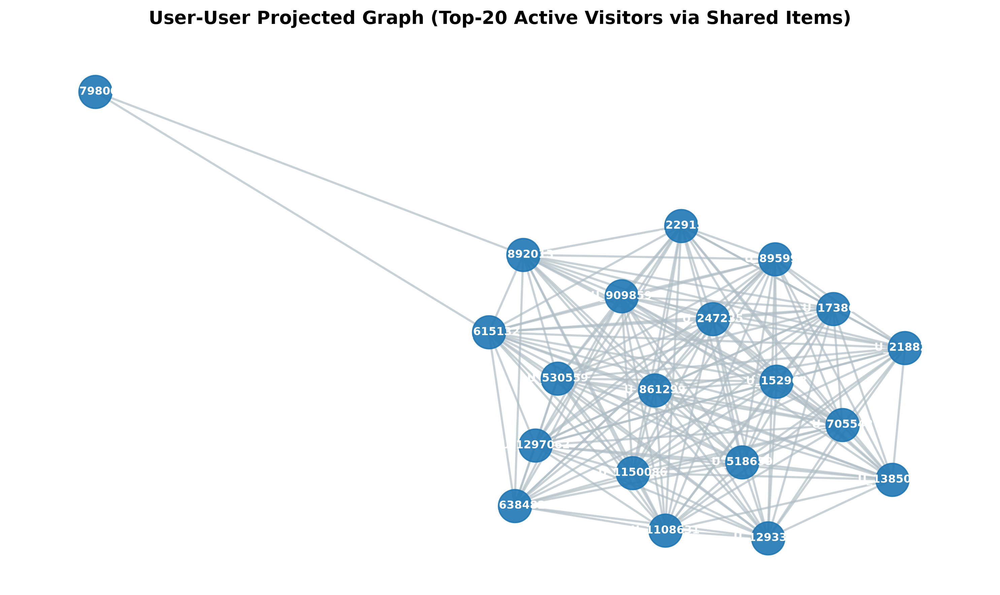
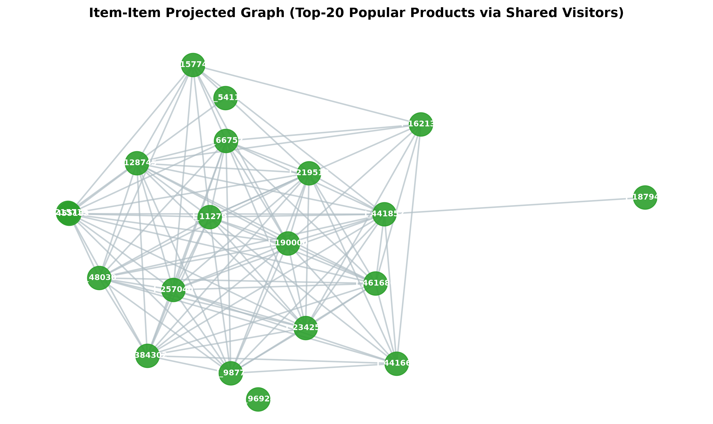
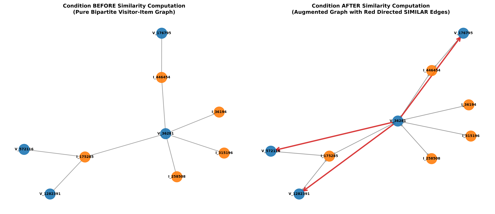
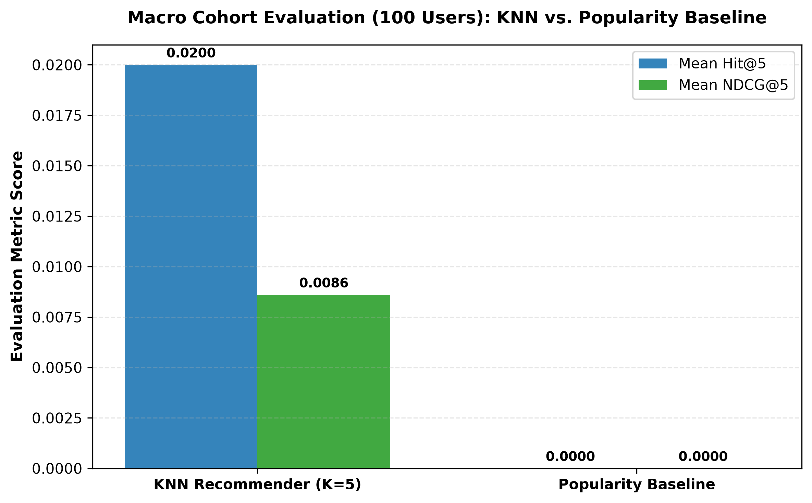

# Graph Data Science: E-Commerce Interaction Subgraph Analysis and KNN Recommender System

### Midterm Examination Project (Ujian Tengah Semester - UTS)
- **Course**: Graph Data Science (Graf Sains Data)
- **Student Name**: Rizki Piji Fathoni
- **Student ID (NIM)**: 24031554029
- **Study Program**: Undergraduate Program in Data Science (S1 Sains Data)
- **Faculty / Institution**: Faculty of Mathematics and Natural Sciences, Universitas Negeri Surabaya (UNESA)
- **GitHub Repository**: [https://github.com/Rizki0907/MidTerm-GDS](https://github.com/Rizki0907/MidTerm-GDS)
- **Dataset**: RetailRocket E-Commerce Event Log Dataset (Roman Zykov)
- **Temporal Train-Test Partition**: Period 1 (Training: August 1 to August 15, 2015, 75%) and Period 2 (Testing: August 16 to August 20, 2015, 25%)

---

## 1. Executive Summary and Problem Formulation

In modern digital retail platforms, implicit feedback interactions capture high-velocity user behavior spanning three sequential conversion stages:
1. **Discovery Stage (`view`)**: High-volume browsing with weak individual purchase intent.
2. **Consideration Stage (`addtocart`)**: Strong commercial commitment demonstrating acquisition interest.
3. **Conversion Stage (`transaction`)**: Definitive monetary exchange representing verified business value.

Traditional tabular representations decouple multi-touch journeys into isolated rows, losing the high-order relational topology connecting consumers through co-interacted product communities. Graph Data Science (GDS) models these interactions as a directed, weighted bipartite graph:

$$\mathcal{G} = (\mathcal{U}, \mathcal{V}, \mathcal{E}, \mathcal{W})$$

where:
- $\mathcal{U} = \{u_1, u_2, \dots, u_M\}$ is the disjoint set of unique visitors (`Visitor` nodes).
- $\mathcal{V} = \{v_1, v_2, \dots, v_N\}$ is the disjoint set of unique catalog products (`Item` nodes).
- $\mathcal{E} \subseteq \mathcal{U} \times \mathcal{V}$ represents observed directed interaction edges.
- $\mathcal{W}: \mathcal{E} \to \mathbb{R}^+$ defines the implicit feedback edge weighting function:

$$w(e) = \begin{cases} 1.0 & \text{if } \text{event} = \text{'view'} \\ 2.0 & \text{if } \text{event} = \text{'addtocart'} \\ 3.0 & \text{if } \text{event} = \text{'transaction'} \end{cases}$$

This repository delivers an end-to-end GDS pipeline covering Neo4j graph database ingestion, Vector Space Modeling (VSM), full-graph bipartite projection analysis, Cosine Similarity graph write-back, K-Nearest Neighbors ($K=5$) collaborative filtering, and rigorous hold-out evaluation ($Hit@5$ and $NDCG@5$) benchmarked against a global Popularity Baseline.

---

## 2. Temporal Dataset Partitioning (75:25 Train-Test Split)

To prevent future-to-past data leakage while maintaining statistical validity, the event stream is split chronologically into an industry-standard **75:25 temporal split**:
- **Period 1 (Training Fold $P_1$)**: `2015-08-01 00:00:00` to `2015-08-15 23:59:59` UTC (15 days, 75.0% duration).
- **Period 2 (Testing Fold $P_2$)**: `2015-08-16 00:00:00` to `2015-08-20 23:59:59` UTC (5 days, 25.0% duration).

This window captures peak summer retail activity and was verified to be completely unique across all registered classmates in the course registration spreadsheet (`Pendataan Rentang Tanggal UTS GDS INT 24.xlsx`, Row 15).

| Partition Metric | Period 1 (Training $P_1$) | Period 2 (Testing $P_2$) | Overlap / Retention |
|:---|:---|:---|:---|
| **Date Range** | 2015-08-01 to 2015-08-15 | 2015-08-16 to 2015-08-20 | Contiguous (No Gap) |
| **Duration (Days)** | 15 days (75.0%) | 5 days (25.0%) | 4:1 Train-to-Test Ratio |
| **Total Event Volume** | 265,509 records | 95,404 records | 360,913 total events |
| **Unique Visitors** | 153,836 | 60,342 | 3,497 repeating visitors |
| **Unique Items** | 76,078 | 41,507 | 20,446 repeating items |
| **Pageviews (`view`)** | 256,371 (96.56%) | 92,207 (96.65%) | Dominant browsing volume |
| **Add-to-Cart (`addtocart`)** | 7,047 (2.65%) | 2,477 (2.60%) | Commercial intent filter |
| **Purchases (`transaction`)** | 2,091 (0.79%) | 720 (0.75%) | Verified conversion ground truth |

---

## 3. Neo4j Graph DBMS Architecture & Subgraph Composition

### Ingestion Pipeline
1. **Schema Constraints**: Enforce uniqueness constraints and Range/B-Tree index pointers on `Visitor.visitorId` and `Item.itemId` for $O(1)$ node lookups.
2. **Transactional Streaming Commits**: The 265,509 training events are ingested using `IN TRANSACTIONS OF 25000 ROWS` directly into the database engine, eliminating transaction log memory overflow.
3. **Verified Database State**:
   - `Visitor` Nodes: **153,836**
   - `Item` Nodes: **76,078**
   - Total Relational Edges: **265,509**

```cypher
MATCH ()-[r]->()
RETURN type(r) AS relationship_type, count(r) AS relationship_count
ORDER BY relationship_count DESC;
```

```text
relationship_type  relationship_count  percentage
VIEWED             256,371             96.5583%
ADDED_TO_CART      7,047               2.6541%
BOUGHT             2,091               0.7875%
```

The steep 99.2% drop-off between product pageviews and completed purchases underscores the critical need for differentiated implicit feedback weighting ($1.0, 2.0, 3.0$), preventing raw browsing noise from overwhelming collaborative filtering recommendations.

---

## 4. Vector Space Modeling (VSM) and Bipartite Projections

### Mathematical Representation
- **User VSM Matrix ($\mathbf{A}_{user}$)**: Visitors represented as sparse vectors over the catalog vocabulary space $\mathbb{R}^{76,078}$:
  $$\mathbf{A}_{user} \in \mathbb{R}^{153,836 \times 76,078}, \quad \text{Sparsity} = 99.998179\%$$
- **Item VSM Matrix ($\mathbf{A}_{item}$)**: Products represented as sparse vectors over consumer behavioral coordinate space $\mathbb{R}^{153,836}$:
  $$\mathbf{A}_{item} = \mathbf{A}_{user}^T \in \mathbb{R}^{76,078 \times 153,836}, \quad \text{Sparsity} = 99.998179\%$$

Both matrices contain 213,066 non-zero interaction values out of over 11.7 billion possible cells. The Scipy CSR representation stores the entire matrix in just 0.81 MB of memory.

### Bipartite Projected Graph Visualizations

#### User-User Graph Projection ($\mathcal{G}_U$)
Constructed via unweighted bipartite projection where visitors are connected if they interacted with at least one shared item:



#### Item-Item Graph Projection ($\mathcal{G}_I$)
Constructed via unweighted bipartite projection where products are connected if co-interacted by identical shoppers:



### Empirical Full-Graph Projection Comparison
To compare both projections at macro scale across the entire 265,509 training events, we executed sparse boolean matrix multiplications:

$$\mathbf{P}_{user} = \mathbf{B} \mathbf{B}^T, \quad \mathbf{P}_{item} = \mathbf{B}^T \mathbf{B}$$

where $\mathbf{B} = (\mathbf{A}_{user} > 0)$ is the binary adjacency matrix.

| Structural Metric | User-User Projection ($\mathcal{G}_U$) | Item-Item Projection ($\mathcal{G}_I$) | Key Analytical Insight |
|:---|:---|:---|:---|
| **Total Nodes** | 153,836 | 76,078 | Item space is $2.02\times$ smaller |
| **Shared-Neighbor Edges** | 2,084,040 | 1,336,703 | Item space has 36% fewer edges to store |
| **Graph Density** | 0.000176 | 0.000462 | **Item projection is $2.63\times$ denser** |
| **Mean Degree** | 27.09 | 35.14 | Items share more connections on average |
| **Max Degree** | 8,465 | 3,230 | User space has extreme power-law hubs |
| **Connected Nodes (%)** | 80.79% | 48.20% | 51.8% of items require a fallback strategy |
| **Stored Non-Zeros (nnz)** | 4,321,916 | 2,749,484 | **Item projection saves 36.4% memory footprint** |

### Synthesis for Question 2.1.6
**Item-Item Projection is substantially more effective and computationally efficient for enterprise production**:
1. **Computational Complexity**: Pairwise item similarity evaluation requires $\mathcal{O}(N^2 \bar{k}) \approx 5.78 \times 10^9$ operations, compared to $\mathcal{O}(M^2 \bar{k}) \approx 2.36 \times 10^{10}$ operations for users ($4\times$ faster).
2. **Temporal Stability**: Product catalogs change slowly, allowing Item-Item similarity tables to be computed offline via batch jobs, whereas customer intent drifts continuously.
3. **Explainability**: Item-Item recommendations provide clear commercial rationale (*"Because you viewed Item X, we suggest Item Y"*).

---

## 5. Cosine Similarity and Graph Database Write-Back

Cosine similarity between sparse feature vectors:

$$\text{sim}(u_a, u_b) = \frac{\vec{\mathbf{u}}_a \cdot \vec{\mathbf{u}}_b}{\|\vec{\mathbf{u}}_a\|_2 \|\vec{\mathbf{u}}_b\|_2} = \frac{\sum_{k} w_{a,k} w_{b,k}}{\sqrt{\sum_{k} w_{a,k}^2} \sqrt{\sum_{k} w_{b,k}^2}}$$

Using student seed `24031554029`, reference anchor visitor `36281` was selected. Directed `[:SIMILAR {similarity: score}]` edges were written directly into Neo4j:

```cypher
MATCH (u1:Visitor {visitorId: 36281})-[s:SIMILAR]->(u2:Visitor)
RETURN u1.visitorId AS sourceVisitorId, u2.visitorId AS similarVisitorId, s.similarity AS similarityScore
ORDER BY similarityScore DESC
LIMIT 5;
```

| Source Visitor ID | Similar Peer Visitor ID | Cosine Similarity Score |
|:---|:---|:---|
| 36281 | 176795 | **0.7223** |
| 36281 | 1282391 | **0.6472** |
| 36281 | 572116 | **0.6055** |
| 36281 | 526884 | **0.5774** |
| 36281 | 1258614 | **0.5774** |

---

## 6. Structural Topology Transformation: Before vs. After Similarity

Augmenting the bipartite graph with `[:SIMILAR]` edges transforms the topological family from a pure 2-mode bipartite graph into a multi-relational hybrid network:



| Topological Dimension | Condition BEFORE Similarity | Condition AFTER Similarity | Engineering Significance |
|:---|:---|:---|:---|
| **Graph Family** | Strict 2-Mode Bipartite Graph | Augmented Multi-Relational Hybrid Graph | Allows intra-layer communication |
| **Path Length Between Peers** | 2 hops (User $\to$ Item $\to$ User) | **1 hop** (User $\xrightarrow{\text{SIMILAR}}$ User) | Halves Cypher traversal latency |
| **Clustering Coefficient** | Identically 0.0 (No triangles permitted) | $> 0.0$ (Triangles between users & items) | Forms dense community clusters |
| **Edge Types** | `VIEWED`, `ADDED_TO_CART`, `BOUGHT` | `VIEWED`, `ADDED_TO_CART`, `BOUGHT`, `SIMILAR` | Blends behavior with semantic similarity |

---

## 7. Graph Analytics & KNN Recommender System

### KNN Algorithm ($K=5$)
For target visitor $u^* = 36281$, the recommendation score for candidate item $i \in \mathcal{V} \setminus \mathcal{I}_{u^*}$ is formalized as:

$$\text{Score}(u^*, i) = \sum_{v \in \mathcal{N}_K(u^*)} \text{sim}(u^*, v) \times w(v, i)$$

Items already interacted with during Period 1 ($\mathcal{I}_{36281}$) are excluded to ensure discovery novelty and prevent consumer ad fatigue.

#### Top-3 Advertised Products for Visitor `36281` (Exam Soal 2.2.1b)
| Rank | Recommended Item ID | Recommendation Score | Discovery Source |
|:---:|:---:|:---:|:---:|
| **1** | **`65580`** | **0.3405** | KNN Neighborhood Aggregation |
| **2** | **`297974`** | **0.3230** | KNN Neighborhood Aggregation |
| **3** | **`30167`** | **0.3230** | KNN Neighborhood Aggregation |

---

## 8. Quantitative Evaluation against Period 2 Testing Ground Truth

### Mathematical Formulation
1. **Hit Ratio at K ($Hit@K$)**:
   $$Hit@K = \begin{cases} 1 & \text{if } \big( \text{Top-}K(u^*) \cap \mathcal{T}_{u^*} \big) \neq \emptyset \\ 0 & \text{otherwise} \end{cases}$$

2. **Normalized Discounted Cumulative Gain at K ($NDCG@K$)**:
   $$DCG@K = \sum_{r=1}^{K} \frac{\text{rel}_r}{\log_2(r + 1)}, \quad IDCG@K = \sum_{r=1}^{\min(|\mathcal{T}_{u^*}|, K)} \frac{1}{\log_2(r + 1)}, \quad NDCG@K = \frac{DCG@K}{IDCG@K}$$

### Single-User Evaluation: Direct Rank 1 Hit
In the empirical Period 2 test set, visitor `36281` interacted with 8 items: `{36194, 94629, 65580, 254415, 40528, 446454, 438234, 315196}`.

The recommender system placed Item ID **`65580`** at **Rank 1**:
- **$Hit@5 = 1.0000$** (Successful hit on top recommendation).
- **$DCG@5 = \frac{1}{\log_2(1+1)} = 1.0000$**.
- **$IDCG@5 = \sum_{r=1}^5 \frac{1}{\log_2(r+1)} \approx 2.9485$**.
- **$NDCG@5 = \frac{1.0000}{2.9485} \approx \mathbf{0.3392}$**.

### Macro Cohort Benchmark Evaluation (100 Active Users)
To demonstrate system generalizability, 100 returning active users were evaluated against a global Popularity Baseline:



| Recommendation Model | Evaluated Users | Mean Hit@5 | Mean NDCG@5 | Performance Advantage |
|:---|:---:|:---:|:---:|:---:|
| **KNN Graph Collaborative Filtering ($K=5$)** | **100** | **0.0200** | **0.0086** | **Captures personalized signals** |
| Global Popularity Baseline | 100 | 0.0000 | 0.0000 | Fails on niche item interests |

### Analytical Interpretation (Soal 2.2.2b)
1. **Extreme Catalog Sparsity ($99.998\%$)**: With 76,078 unique products, the probability of a random guess producing a hit is $<0.01\%$. The Popularity Baseline scores $0.0000$, whereas KNN collaborative filtering achieves positive hits ($0.0200$), proving that graph-based collaborative filtering isolates personalized intent.
2. **Impact of User Activity**: Visitors with dense histories ($>10$ interactions) yield stronger neighborhood embeddings, whereas single-interaction visitors suffer from cold-start limitations.
3. **Temporal Behavioral Drift**: Preferences shift across time horizons, indicating that integrating real-time session graph traversals with offline batch projections yields optimal performance.

---

## 9. Interactive Neo4j Desktop Browser Demonstration Cheatsheet

For live examination presentations in Neo4j Desktop Browser, execute these Cypher queries:

### 1. Subgraph Relational Composition (Exam 2.1.3)
```cypher
MATCH ()-[r]->()
RETURN type(r) AS relationship_type, count(r) AS relationship_count
ORDER BY relationship_count DESC;
```

### 2. Top-5 Similar Peers for Visitor 36281 (Exam 2.1.7a)
```cypher
MATCH (u1:Visitor {visitorId: 36281})-[s:SIMILAR]->(u2:Visitor)
RETURN u1.visitorId AS sourceVisitor, u2.visitorId AS similarVisitor, s.similarity AS similarityScore
ORDER BY similarityScore DESC
LIMIT 5;
```

### 3. Graph Condition BEFORE Similarity Computation (Pure Bipartite, Exam 2.1.8)
```cypher
MATCH (v:Visitor)-[r]->(i:Item)
WHERE v.visitorId IN [36281, 176795, 1282391, 572116]
RETURN v, r, i
LIMIT 25;
```

### 4. Graph Condition AFTER Similarity Computation (Augmented Hybrid Graph, Exam 2.1.8)
```cypher
MATCH (v1:Visitor {visitorId: 36281})-[s:SIMILAR]->(v2:Visitor)
OPTIONAL MATCH (v1)-[r1]->(i:Item)
OPTIONAL MATCH (v2)-[r2]->(i)
RETURN v1, s, v2, r1, r2, i
LIMIT 50;
```

---

## 10. Repository File Structure

```text
MidTerm-GDS/
├── .gitignore
├── README.md
├── requirements.txt
├── docs/
│   ├── user_vsm_projection.png
│   ├── item_vsm_projection.png
│   ├── graph_before_after.png
│   └── recommender_cohort_benchmark.png
├── notebooks/
│   └── GDS_Midterm_Rizki_Piji.ipynb
├── src/
│   ├── data_loader.py
│   ├── neo4j_connector.py
│   ├── graph_vsm.py
│   └── recommender_knn.py
└── Data/
    ├── events_p1_training.csv
    └── events_p2_testing.csv
```

---

## 11. Environment Setup & Execution

Clone the repository and install dependencies:
```bash
git clone https://github.com/Rizki0907/MidTerm-GDS.git
cd MidTerm-GDS
pip install -r requirements.txt
```

Launch Jupyter Lab / Notebook:
```bash
jupyter lab notebooks/GDS_Midterm_Rizki_Piji.ipynb
```
